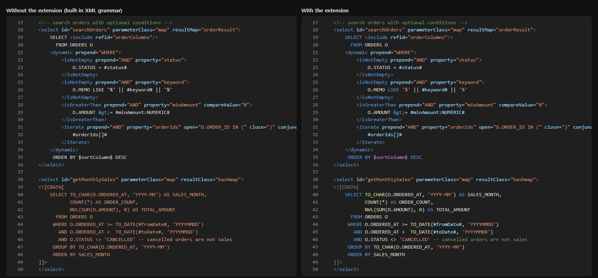

# iBATIS sqlMap SQL

SQL syntax highlighting inside **iBATIS 2 sqlMap XML** (and MyBatis 3 mapper XML) for VS Code.

The built-in XML grammar paints a whole `<![CDATA[ ... ]]>` body as one string and leaves SQL outside CDATA uncolored. This extension injects into the XML grammar so that statement bodies are colored as SQL. The file language stays XML, and nothing outside `<sqlMap>` / `<mapper>` changes.



## Features

- Bodies of `<select>`, `<insert>`, `<update>`, `<delete>`, `<statement>`, `<procedure>` and `<sql>` inside a `<sqlMap>` or `<mapper>` root, both inside and outside CDATA.
- iBATIS 2 inline parameters: `#id#`, `#list[]#`, `#amount:NUMERIC#`, `#amount:NUMERIC:0#`, `#status,jdbcType=VARCHAR#`. String substitution `$sortColumn$` gets a different color, so it stands out.
- parameterMap-style `?` placeholders (also `??`), and JDBC escapes such as `{call PKG.PROC(?, ?)}` and `{? = call FN(?)}`.
- MyBatis 3 `#{...}` and `${...}`.
- Dynamic tags (`<dynamic>`, `<isNotEmpty>`, `<iterate>`, `<if>`, `<where>`, `<foreach>`, `<include>`, ...) keep their XML colors.
- SQL strings, `--` and `/* */` comments, numbers, keywords and common functions (Oracle and MySQL flavored). An unclosed quote or comment never leaks past `]]>` or the closing statement tag.
- iBATIS.NET maps (`<statements>` wrapper, `xmlns` on the root) work too.
- Inside CDATA, **Toggle Line Comment** (`Ctrl+/`) inserts `--`.

## Limits

- Coloring only. No navigation, completion, validation or formatting.
- Keywords and functions come from a fixed word list, not a SQL parser. Words outside the list keep the default color.
- The built-in SQL grammar is deliberately not reused: its multi-line rules swallow `]]>` and closing tags, and its large word list made large map files much slower to tokenize.
- Only files whose root is `<sqlMap>` or `<mapper>` are affected. If the root's opening tag spans several lines, it needs a `namespace=` attribute to be recognized. Other XML (sqlMapConfig, mybatis-config, Ant builds) is colored exactly as before.
- A `{call ...}` that spans several lines gets only its head colored.

## Scopes

Colors come from your theme. To adjust them, use these scopes in `editor.tokenColorCustomizations.textMateRules`:

| What | Scope |
|---|---|
| `#x#`, `#{x}`, `?` | `variable.parameter.bind.sqlmap` |
| `$x$`, `${x}` | `keyword.control.substitution.sqlmap` |
| SQL keywords | `keyword.other.sql` |
| SQL functions | `support.function.sql` |
| Procedure name in `{call ...}` | `entity.name.function.sql` |
| SQL in CDATA / outside CDATA | `meta.embedded.block.sql` / `meta.embedded.inline.sql` |

## Development

```
node test/tokenize_check.js            # tokenizes samples/ and runs the fixture assertions
node test/tokenize_check.js --corpus <folder with your sqlMap files>
node tools/preview.js                  # writes tools/out/preview.html (without / with the extension)
```

Both scripts load the TextMate tokenizer (`vscode-textmate`, `vscode-oniguruma`) from an installed editor's `resources/app/node_modules`; `preview.js` also reads its default Dark Modern and Light Modern themes. Use `--app <.../resources/app>` to point at an editor where those modules are plain folders.

## 한국어 요약

iBATIS 2 sqlMap XML(MyBatis 3 mapper 포함)의 문장 본문을 SQL 색으로 칠하는 확장. CDATA 안팎 모두, `#x#`·`#x:TYPE#`·`$x$`·`?`·`{call ..}`·`#{}`·`${}` 를 구분해 칠함. 파일 언어는 XML 그대로이고 `<sqlMap>`·`<mapper>` 루트 밖은 바꾸지 않음(루트 여는 태그가 여러 줄이면 `namespace=` 필요). 색만 입히며 이동·자동완성·검증은 없음.

## License

[MIT](LICENSE)
